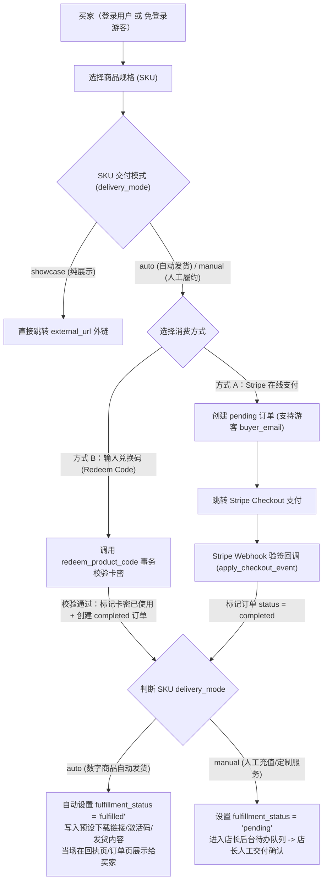

# 项目全面审查与「标准商品展示/售卖 SaaS 模板」可执行改造规范

更新日期：2026-10-28  
目标读者：后续负责代码落地的 AI Coding Agent / 开发者  
适用仓库：`game-recharge-platform`

---

## 0. 已拍板的核心产品与架构决策（Agent 必须严格遵循）

经过与项目主理人对齐，本项目将从「单一游戏人工充值平台」升级为**「可复用、标准化的自营商品展示与售卖 SaaS 模板」**。后续执行 Agent 必须按照以下 **5 项已确认决策** 实施改造：

1. **店铺模式：单主理人/自营商城模板（Single-Owner Storefront）**
   - 隐藏普通用户在注册页勾选“注册为商户（MERCHANT）”的入口，移除公开商户自助注册逻辑。
   - 新增集中式站点配置文件 `src/config/site.ts`，支持一键配置品牌名、Logo、中英文 Hero 标语、联系方式与主题。
   - 店长（ADMIN / 主理人）通过统一的管理后台发布商品、管理库存/兑换码与处理订单。
2. **消费与购买方式：Stripe 在线支付 + 跨平台「兑换码（Redeem Code）」直接兑换**
   - **新增「兑换码购买/核销」消费模式**：买家在第三方平台（如淘宝、闲鱼、小红书、微信小店、Gumroad 等）下单获得兑换码后，无需再次走 Stripe 支付，直接在站内输入兑换码即可完成兑换下单并获取商品！
   - **店长后台支持兑换码管理**：支持按商品（SKU）批量生成唯一兑换码、一键复制/导出未使用的兑换码、查看核销状态与关联订单。
3. **商品交付方式：「自动发货（Auto）+ 人工履约（Manual）+ 纯展示外链（Showcase）」三合一**
   - **`auto`（自动发货，默认）**：免填游戏 ID 和区服。无论是 Stripe 付款成功还是兑换码核销成功，系统立即将订单标记为已交付（`fulfillment_status = 'fulfilled'`），并直接向买家展示预设的交付内容（如下载链接、网盘口令、软件激活码、发货说明）。
   - **`manual`（人工履约/定制服务/充值）**：按需收集买家接收信息（如账号 ID、区服或备注），付款或兑换码核销后进入店长后台待处理队列，由店长处理后确认交付。
   - **`showcase`（纯展示/外链导购）**：展示商品图文与价格，点击主按钮直接跳转外部链接（如 App Store、GitHub、第三方店铺链接）。
4. **买家身份门槛：支持「游客免登录结账/兑换（Guest Checkout & Redeem）」+「登录购买」双模式**
   - 未登录访客无需注册即可直接拉起 Stripe 支付或输入兑换码核销（仅需提供接收邮箱或由 Stripe 收集邮箱）。
   - 同时也支持注册登录，登录用户可在「我的订单」永久查看历史订单与交付内容。
5. **修复密码重置邮件与全站前端 SaaS 级重构**
   - 彻底解决重置密码跨浏览器失效、邮件模板 URL 拼接损坏、过期无提示等 Bug。
   - 重构全站 UI：全局统一吸顶导航栏与页脚、首页 Hero + 搜索过滤 + 响应式多列商品网格、现代化后台与弹窗式商品编辑器。

---

## 1. 现状代码审查：问题清单与根因定位

### 1.1 重置密码与邮件链路缺陷

| 编号 | 问题现象 / 隐患 | 根因文件与行号 | 具体修复方法 |
| :--- | :--- | :--- | :--- |
| **E-1** | **跨浏览器 / 手机打开重置邮件必败** | [`src/actions/password.actions.ts`](../src/actions/password.actions.ts) + [`src/app/[locale]/auth/callback/route.ts`](../src/app/[locale]/auth/callback/route.ts) | 默认 `ConfirmationURL` 采用 PKCE，必须在发起请求的同一浏览器读取 `code_verifier` Cookie。用户在手机邮件 App 或内置浏览器打开即失败。应使用 `token_hash` 服务端直验（`verifyOtp({ token_hash, type: "recovery" })`），彻底解耦同浏览器限制。 |
| **E-2** | **邮件模板 URL 参数拼接产生损坏链接** | [`supabase/templates/recovery.html`](../supabase/templates/recovery.html) | 当前写死 `{{ .RedirectTo }}&token_hash={{ .TokenHash }}&type=recovery`（直接用 `&`）。若回退至不含 `?` 的 `Site URL`，会产生非法 URL。应改为 `{{ .SiteURL }}/en/auth/callback?token_hash={{ .TokenHash }}&type=recovery&next=/en/auth/reset`，并在回调路由中根据用户 Cookie 或 Referer 适配语言。 |
| **E-3** | **重置链接过期时前端静默无报错** | [`src/components/features/password-form.tsx`](../src/components/features/password-form.tsx) | `auth/callback/route.ts` 校验失败会重定向至 `/[locale]/auth/forgot?error=expired`，但 `PasswordForm` 未读取 `useSearchParams().get("error")`。需在 `PasswordForm` 中读取 `error` 参数并渲染醒目的错误横幅。 |
| **E-4** | **注册邮件 Origin 在预览环境不匹配白名单** | [`src/actions/auth.actions.ts`](../src/actions/auth.actions.ts) | `registerAction` 调用了 `getAppOrigin()` 而非 `getRequestOrigin()`。在 Vercel Preview 下会使用每次变化的 deployment hash 域名，导致无法命中 Supabase Redirect URLs 白名单。应改为 `await getRequestOrigin()`。 |
| **E-5** | **提示文案误导用户“必须在当前浏览器打开”** | [`src/actions/password.actions.ts`](../src/actions/password.actions.ts) | 升级为 `token_hash` 服务端直验后，移除“请在当前浏览器中打开邮件链接”的限制性提示。 |

### 1.2 前端视觉与交互体验问题

| 编号 | 问题现象 | 根因文件 | 具体改进要求 |
| :--- | :--- | :--- | :--- |
| **U-1** | **首页布局简陋，缺乏商城感** | [`src/app/[locale]/page.tsx`](../src/app/[locale]/page.tsx) | 当前为 `max-w-2xl` 单列窄列表，且未挂载已有的 [`search-bar.tsx`](../src/components/features/search-bar.tsx)。需重构为：**品牌 Hero 区（含快捷「兑换码核销」入口）+ 搜索与分类筛选栏 + 响应式 3 列商品网格（`grid-cols-1 md:grid-cols-2 lg:grid-cols-3`）**。 |
| **U-2** | **缺乏统一的全局导航栏与页脚** | [`src/app/[locale]/layout.tsx`](../src/app/[locale]/layout.tsx)、[`game-detail-client.tsx`](../src/components/features/game-detail-client.tsx) | 首页与详情页各自重复写了 Header，详情页右上角用户区甚至是空 `<div />`；订单页、认证页、后台页无全局导航。需新建 `src/components/layout/navbar.tsx` 与 `footer.tsx` 并在 `[locale]/layout.tsx` 统一挂载。 |
| **U-3** | **表单与后台页面为“裸 HTML”** | [`auth-form.tsx`](../src/components/features/auth-form.tsx)、[`password-form.tsx`](../src/components/features/password-form.tsx)、[`order-table.tsx`](../src/components/features/order-table.tsx)、[`admin/page.tsx`](../src/app/[locale]/dashboard/admin/page.tsx) | 全面替换为统一的卡片容器、带图标与焦点高亮的输入框、彩色状态 Badge（已付款/兑换核销/已自动发货/待人工处理）以及移动端友好的响应式表格。 |
| **U-4** | **后台商品编辑器平铺且要求手填美分** | [`src/components/features/merchant/catalogue-editor.tsx`](../src/components/features/merchant/catalogue-editor.tsx) | 改为商品折叠卡片 + 模态框/抽屉编辑；价格输入框改为支持美元小数（如输入 `10.99` 自动转为 `1099` 美分存储）；新增交付模式切换（`auto` / `manual` / `showcase`）与兑换码批量生成面板。 |

### 1.3 支付、兑换与履约耦合问题

| 编号 | 问题现象 | 根因文件 | 具体改进要求 |
| :--- | :--- | :--- | :--- |
| **P-1** | **结账弹窗强制要求填写“游戏 ID + 区服”** | [`src/components/features/sku-detail-modal.tsx`](../src/components/features/sku-detail-modal.tsx)、[`src/actions/payment.actions.ts`](../src/actions/payment.actions.ts) | 仅当 SKU 的 `delivery_mode === "manual"` 时展示自定义接收信息输入框（标签可配置，默认“接收账号/备注”）；当 `delivery_mode === "auto"` 时免填繁琐字段，直接一键 Stripe 支付或输入兑换码。 |
| **P-2** | **缺少跨平台「兑换码（Redeem Code）」核销闭环** | 数据库与 `src/actions/` | 新增 `redeem_codes` 表、核销 RPC 函数 `redeem_product_code` 及 `src/actions/redeem.actions.ts`，在商品购买弹窗内提供「在线支付（Stripe）」与「兑换码兑换（Redeem Code）」双 Tab 切换，并新增独立 `/[locale]/redeem` 快速兑换页。 |
| **P-3** | **缺少自动发货闭环与游客购买支持** | [`src/app/api/webhooks/stripe/route.ts`](../src/app/api/webhooks/stripe/route.ts)、SQL 迁移 | 更新 `orders` 表支持 `user_id NULL` 与 `buyer_email`；更新 `apply_checkout_event` 与 `redeem_product_code`：若关联 SKU 为 `auto` 模式，付款/核销成功瞬间自动将 `fulfillment_status` 设为 `'fulfilled'` 并写入 `fulfillment_note = sku.auto_delivery_content`。 |
| **P-4** | **遗留冗余 API 路由** | `src/app/api/auth/*`、`src/app/[locale]/api/auth/*`、`src/app/api/placeholder/*` | 删除未被使用的遗留 REST 路由，所有认证与业务写操作统一收敛至 `src/actions/*` Server Actions。 |

---

## 2. 核心业务流程与状态机设计



---

## 3. 数据库增量迁移规范（SQL Migration）

> **重要安全规则**：严禁重置已有数据库或修改历史迁移文件。请新建迁移文件 `supabase/migrations/20261029000000_saas_storefront_and_redeem.sql`，保证幂等可重复执行（`IF NOT EXISTS` / `CREATE OR REPLACE`）。

### 3.1 表结构扩展与 `redeem_codes` 新表设计

请在 `20261029000000_saas_storefront_and_redeem.sql` 中实现以下 DDL 与函数：

1. **扩展 `games` 表（作为通用商品系列/产品线 Catalog Item）**：
   - `is_published BOOLEAN NOT NULL DEFAULT true`（上下架控制）
   - `sort_order INTEGER NOT NULL DEFAULT 0`（展示排序权重）
   - `category TEXT NOT NULL DEFAULT 'general'`（商品分类标签，如 `saas`、`template`、`service`、`game`）
2. **扩展 `skus` 表（支持三种交付模式与自动发货内容）**：
   - `delivery_mode TEXT NOT NULL DEFAULT 'auto' CHECK (delivery_mode IN ('auto', 'manual', 'showcase'))`
   - `auto_delivery_content TEXT`（当 `delivery_mode = 'auto'` 时，付款或兑换成功后自动发放给买家的下载链接、卡密口令或使用说明）
   - `external_url TEXT`（当 `delivery_mode = 'showcase'` 时点击跳转的外部 HTTPS 链接）
   - `requires_recipient_info BOOLEAN NOT NULL DEFAULT false`（是否要求买家填写接收账号/区服/备注；`manual` 模式默认开启，`auto` 模式默认关闭）
   - `recipient_label JSONB DEFAULT '{"en": "Account / Recipient Info", "zh": "接收账号 / 备注信息"}'::jsonb`（自定义输入框标签，替代写死的“游戏 ID”）
3. **扩展 `orders` 表（支持游客免登录购买与兑换码来源追踪）**：
   - `ALTER TABLE public.orders ALTER COLUMN user_id DROP NOT NULL;`（允许游客下单）
   - `ADD COLUMN IF NOT EXISTS buyer_email TEXT`（游客或买家的联系邮箱）
   - `ADD COLUMN IF NOT EXISTS access_token UUID NOT NULL DEFAULT gen_random_uuid()`（用于游客免登录安全查看单笔订单回执与交付内容的唯一凭证）
   - `ADD COLUMN IF NOT EXISTS redeem_code_id UUID`（若通过兑换码购买，关联核销的兑换码 ID）
   - 更新 `orders.payment_mode` 检查约束以支持 `'redeem'`：
     ```sql
     ALTER TABLE public.orders DROP CONSTRAINT IF EXISTS orders_payment_mode_check;
     ALTER TABLE public.orders ADD CONSTRAINT orders_payment_mode_check
       CHECK (payment_mode IN ('test', 'live', 'unknown', 'redeem'));
     ```
4. **新建 `redeem_codes` 表（跨平台兑换码/卡密表）**：
   ```sql
   CREATE TABLE IF NOT EXISTS public.redeem_codes (
     id UUID PRIMARY KEY DEFAULT gen_random_uuid(),
     code TEXT NOT NULL UNIQUE CHECK (char_length(trim(code)) BETWEEN 6 AND 64),
     sku_id UUID NOT NULL REFERENCES public.skus(id) ON DELETE RESTRICT,
     merchant_id UUID NOT NULL REFERENCES public.profiles(id) ON DELETE CASCADE,
     batch_note TEXT,
     custom_delivery_content TEXT, -- 可选：一码一密专属发货内容（优先级高于 sku.auto_delivery_content）
     status TEXT NOT NULL DEFAULT 'active' CHECK (status IN ('active', 'redeemed', 'disabled')),
     redeemed_by_user_id UUID REFERENCES auth.users(id) ON DELETE SET NULL,
     redeemed_by_email TEXT,
     order_id UUID REFERENCES public.orders(id) ON DELETE SET NULL,
     expires_at TIMESTAMPTZ,
     redeemed_at TIMESTAMPTZ,
     created_at TIMESTAMPTZ NOT NULL DEFAULT now()
   );

   ALTER TABLE public.redeem_codes ENABLE ROW LEVEL SECURITY;

   -- 仅所属商户或 ADMIN 可读写管理兑换码；普通买家绝不能直接 SELECT redeem_codes 表（防枚举泄露），必须通过 SECURITY DEFINER RPC 核销
   DROP POLICY IF EXISTS "redeem_codes_owner_select" ON public.redeem_codes;
   CREATE POLICY "redeem_codes_owner_select" ON public.redeem_codes
     FOR SELECT TO authenticated
     USING (
       merchant_id = auth.uid()
       OR EXISTS (SELECT 1 FROM public.profiles p WHERE p.id = auth.uid() AND p.role = 'ADMIN')
     );

   DROP POLICY IF EXISTS "redeem_codes_owner_write" ON public.redeem_codes;
   CREATE POLICY "redeem_codes_owner_write" ON public.redeem_codes
     FOR ALL TO authenticated
     USING (
       merchant_id = auth.uid()
       OR EXISTS (SELECT 1 FROM public.profiles p WHERE p.id = auth.uid() AND p.role = 'ADMIN')
     )
     WITH CHECK (
       merchant_id = auth.uid()
       OR EXISTS (SELECT 1 FROM public.profiles p WHERE p.id = auth.uid() AND p.role = 'ADMIN')
     );

   REVOKE ALL ON public.redeem_codes FROM anon;
   ```

### 3.2 核心数据库事务函数（RPC）

1. **新增原子核销兑换码函数 `public.redeem_product_code`**：
   - 输入参数：
     - `p_code TEXT`（用户输入的兑换码，内部统一 `upper(trim(p_code))`）
     - `p_sku_id UUID DEFAULT NULL`（可选：若在特定商品弹窗内兑换则校验是否匹配该 SKU；若在全局兑换页兑换则自动识别对应的 SKU）
     - `p_user_id UUID DEFAULT NULL`（当前登录用户 ID，游客为 `NULL`）
     - `p_buyer_email TEXT DEFAULT NULL`
     - `p_player_account TEXT DEFAULT NULL`
     - `p_game_server TEXT DEFAULT NULL`
   - 事务逻辑（使用 `FOR UPDATE` 行锁防止并发双花）：
     1. 查询并锁定 `redeem_codes` 中 `upper(trim(code)) = upper(trim(p_code))` 的记录。
     2. 若不存在，抛出异常 `'INVALID_REDEEM_CODE'`；若 `status <> 'active'`，抛出 `'CODE_ALREADY_USED'`；若 `expires_at IS NOT NULL AND expires_at < now()`，抛出 `'CODE_EXPIRED'`；若传入了 `p_sku_id` 且与 `redeem_codes.sku_id` 不一致，抛出 `'CODE_SKU_MISMATCH'`。
     3. 联表查询对应的 `skus` 与 `games`。若 `skus.delivery_mode = 'manual'` 且 `skus.requires_recipient_info = true`，校验 `p_player_account` 非空。
     4. 计算交付状态：
        - 若 `skus.delivery_mode = 'auto'`，则 `v_fulfillment_status := 'fulfilled'`，`v_fulfillment_note := COALESCE(nullif(trim(v_code.custom_delivery_content), ''), nullif(trim(v_sku.auto_delivery_content), ''), 'Auto-fulfilled via redeem code')`，`v_fulfilled_at := now()`。
        - 若 `skus.delivery_mode = 'manual'`，则 `v_fulfillment_status := 'pending'`，`v_fulfillment_note := NULL`，`v_fulfilled_at := NULL`。
     5. 插入 `public.orders`（`status = 'completed'`, `payment_mode = 'redeem'`, `amount = v_sku.prices->>'usd'`, `redeem_code_id = v_code.id`, `fulfillment_status = v_fulfillment_status`, `fulfillment_note = v_fulfillment_note`, `fulfilled_at = v_fulfilled_at`），获取 `v_order_id` 和 `v_access_token`。
     6. 更新 `public.redeem_codes`：`status = 'redeemed'`, `redeemed_by_user_id = p_user_id`, `redeemed_by_email = p_buyer_email`, `order_id = v_order_id`, `redeemed_at = now()`。
     7. 返回 JSON：`{ order_id, access_token, fulfillment_status, fulfillment_note, sku_id }`。

2. **升级 Stripe 回调事务函数 `public.apply_checkout_event`**：
   - 在将订单 `status` 更新为 `'completed'` 时，同时检查关联 `skus.delivery_mode`：
     - 如果 `delivery_mode = 'auto'`，在同一个 UPDATE 语句中自动将 `fulfillment_status` 更新为 `'fulfilled'`、`fulfilled_at = now()`，并将 `fulfillment_note` 设为 `COALESCE(orders.fulfillment_note, skus.auto_delivery_content, 'Delivered automatically')`！
     - 如果 `delivery_mode = 'manual'`，保持原有的 `fulfillment_status = 'pending'` 人工待办逻辑不变。

---

## 4. 代码层详细改造清单（File-by-File Specification）

### Phase 1：修复密码重置邮件与清理遗留认证路由

1. **[`supabase/templates/recovery.html`](../supabase/templates/recovery.html)**
   - 修复 `&` 硬编码拼接问题，确保即使 `RedirectTo` 无查询参数也能正常工作，或提供基于 `SiteURL` + `TokenHash` 的标准链接。
2. **[`src/app/[locale]/auth/callback/route.ts`](../src/app/[locale]/auth/callback/route.ts)**
   - 支持 `token_hash` 与 `type=recovery`（以及 `type=signup` / `type=email`）通过 `db.auth.verifyOtp` 服务端直接验证，验证成功后若存在 `next` 参数且合法则跳转 `next`，否则当 `type === "recovery"` 时默认跳转 `/${locale}/auth/reset`。
3. **[`src/components/features/password-form.tsx`](../src/components/features/password-form.tsx)**
   - 引入 `useSearchParams()`，当 `searchParams.get("error") === "expired"` 时，在表单顶部渲染清晰的红色/琥珀色警告框（中文：`重置链接已过期或失效，请重新发送重置邮件。` / 英文：`This reset link is invalid or expired. Please request a new one.`）。
4. **[`src/actions/password.actions.ts`](../src/actions/password.actions.ts) & [`src/actions/auth.actions.ts`](../src/actions/auth.actions.ts)**
   - `registerAction` 中的 `getAppOrigin()` 统一替换为 `await getRequestOrigin()`。
   - `registerAction` 仅允许创建 `USER` 角色（单主理人商城模式下禁止外部用户通过注册接口自建 `MERCHANT` 身份，除非环境变量 `ALLOW_MERCHANT_SIGNUP=true`）。
   - 更新 `requestPasswordReset` 返回的成功提示文案，去掉“请在当前浏览器中打开”的限制。
5. **删除遗留冗余的 API 路由**
   - 删除 `src/app/api/auth/login/route.ts`、`src/app/api/auth/logout/route.ts`、`src/app/[locale]/api/auth/login/route.ts`、`src/app/[locale]/api/auth/logout/route.ts`、`src/app/[locale]/api/auth/register/route.ts`、`src/app/[locale]/api/auth/ensure-profile/route.ts`。
   - 检查并更新引用这些旧路由的测试文件，统一测试 `src/actions/auth.actions.ts`。

---

### Phase 2：站点配置化、兑换码核销体系与游客免登录购买

1. **新建站点配置中心 `src/config/site.ts`**
   - 集中导出品牌配置：
     ```ts
     export const siteConfig = {
       name: process.env.NEXT_PUBLIC_SITE_NAME || "NexusStore",
       logoText: process.env.NEXT_PUBLIC_SITE_LOGO || "NX",
       allowMerchantSignup: process.env.NEXT_PUBLIC_ALLOW_MERCHANT_SIGNUP === "true",
       hero: {
         en: {
           badge: "Instant Digital Delivery & Redeem Center",
           title: "Premium Digital Products & Services",
           subtitle: "Purchase instantly via Stripe or redeem your code from partner marketplaces.",
         },
         zh: {
           badge: "支持即时自动发货与跨平台卡密兑换",
           title: "精选数字商品与标准服务商城",
           subtitle: "支持 Stripe 在线支付，或直接使用第三方平台购买的兑换码一键核销提货。",
         },
       },
     };
     ```
2. **新建兑换码 Server Actions `src/actions/redeem.actions.ts`**
   - `redeemCodeAction`（公开可调用，支持登录用户与免登录游客）：
     - 输入：`code`、`skuId`（可选）、`buyerEmail`（可选）、`playerAccount`（可选）、`gameServer`（可选）、`locale`。
     - 使用 `createSupabaseAdminClient()` 调用 RPC `redeem_product_code`，将数据库错误码映射为用户友好的中英文提示（如兑换码无效、已被使用、已过期、不适用于当前商品）。
     - 成功后返回 `{ success: true, orderId, accessToken, redirectUrl: `/${locale}/orders/${orderId}?token=${accessToken}` }`。
   - `generateRedeemCodesAction`（仅店长/商户可调用）：
     - 输入：`skuId`、`count`（1~200）、`batchNote`（可选）、`customDeliveryContents`（可选：支持按行粘贴一码一密内容）、`expiresInDays`（可选）。
     - 自动生成高熵易读的唯一兑换码（格式如 `NX-XXXX-XXXX-XXXX`，排除易混淆字符 `0/O/1/I`），批量插入 `redeem_codes` 表并返回生成的卡密列表供店长一键复制/导出 CSV。
   - `toggleRedeemCodeStatusAction`（作废/启用未使用的兑换码）。
3. **升级 `src/actions/payment.actions.ts` 支持游客免登录与三种交付模式**
   - 移除未登录拦截（`if (!user) return ...`），改为：`user` 存在时记录 `user_id: user.id`，游客时 `user_id: null` 并记录 `buyer_email`。
   - 根据 SKU 的 `delivery_mode` 和 `requires_recipient_info` 动态决定是否校验 `playerAccount` / `gameServer`。若 `delivery_mode === 'auto'` 且无需接收账号，则将其存为 `null`。
   - Stripe `success_url` 附带订单 `access_token`：`${origin}/${locale}/payment/success?session_id={CHECKOUT_SESSION_ID}&token=${order.access_token}`，使游客支付跳回后也能免登录查看订单状态与自动发货内容。
4. **新建独立订单回执与交付物查看页 `src/app/[locale]/orders/[orderId]/page.tsx` 及快速兑换页 `src/app/[locale]/redeem/page.tsx`**
   - 支持已登录买家（匹配 `user_id`）或游客（匹配 URL 查询参数 `?token=<access_token>`）查看订单详情、支付方式（Stripe / 兑换码）以及高亮显示的**已交付内容（兑换码/下载链接/发货说明，带一键复制按钮）**。
   - `/[locale]/redeem` 页面允许用户无需先找商品，直接输入兑换码即可自动匹配对应商品并完成核销提货。

---

### Phase 3：全站前端 SaaS 级视觉重构

1. **全局导航栏与页脚（`src/components/layout/navbar.tsx` & `footer.tsx`）**
   - 挂载于 `src/app/[locale]/layout.tsx`（移除首页和详情页各自重复硬编码的 `<header>`）。
   - 导航栏包含：品牌 Logo 与名称（读取 `siteConfig`）、『全部商品』、『兑换中心（Redeem）』、语言切换器、登录/我的订单/管理后台入口。
2. **商城首页重构（`src/app/[locale]/page.tsx`）**
   - **顶部 Hero 横幅**：渐变背景卡片，展示中英文大标题、副标题，并提供『浏览商品』与『输入兑换码提货（跳转 `/redeem`）』两个核心行动按钮。
   - **筛选与搜索工具栏**：挂载实时搜索框与分类胶囊标签（全部 / 数字商品 / 定制服务等）。
   - **多列商品网格**：使用 `grid-cols-1 md:grid-cols-2 lg:grid-cols-3 gap-6` 展示商品卡片（[`game-card.tsx`](../src/components/features/game-card.tsx)），卡片上显示起售价（`From $X.XX`）、商品规格数与交付模式徽章（⚡ 自动发货 / 🛠 人工交付）。
3. **商品详情与购买/兑换一体化弹窗（`src/components/features/sku-detail-modal.tsx`）**
   - 当点击某个 SKU 时：
     - 若 `delivery_mode === "showcase"`，直接打开外部链接或展示外链引导。
     - 否则打开精致的购买弹窗，内部提供两个切换 Tab：
       - **Tab 1：💳 在线支付（Stripe Checkout）**
       - **Tab 2：🎟️ 兑换码提货（Redeem Code）**——专为在其他平台下单拿到卡密的用户设计，输入兑换码点击“立即兑换”即可直接完成下单并跳转提货页！
     - 若 `requires_recipient_info === false`（默认 `auto` 模式），隐藏“游戏 ID / 区服”输入框，实现极简一键购买/兑换。
4. **店长管理后台重构（`src/app/[locale]/dashboard/...`）**
   - **商品与 SKU 编辑器（[`catalogue-editor.tsx`](../src/components/features/merchant/catalogue-editor.tsx)）**：
     - 价格输入改为美元小数（如输入 `9.99` 前端自动换算为 `999` 美分传给后端）。
     - 支持选择 SKU 交付模式（`⚡ 自动发货` / `🛠 人工履约` / `🔗 外链展示`），并在选择自动发货时提供多行文本框填写预设发货内容（下载链接、群口令、密钥等）。
   - **新增「兑换码管理（Redeem Codes）」面板**：
     - 选择 SKU 与数量一键生成卡密、支持填入批次备注（如“闲鱼批次01”）、支持一键复制全部未使用卡密、查看每张卡密的核销状态与关联订单。

---

## 5. 验证与交付标准（Definition of Done）

后续执行 Agent 完成上述代码编写后，必须依次运行并通过以下验证命令：

```bash
pnpm lint
pnpm typecheck
pnpm test
pnpm build
pnpm e2e
```

### 必测用例清单（Unit + PGlite + Playwright）
1. **密码重置闭环测试**：验证 `token_hash` + `type=recovery` 在无 PKCE Cookie 时仍能成功建立会话并跳转到 `/[locale]/auth/reset`；验证过期时 `/[locale]/auth/forgot?error=expired` 显示错误提示。
2. **兑换码事务安全测试（PGlite）**：
   - 验证有效兑换码核销后自动生成 `status = 'completed'`, `payment_mode = 'redeem'` 的订单，且 `auto` 商品立即变为 `fulfillment_status = 'fulfilled'` 并返回发货内容。
   - 验证同一个兑换码第二次核销时被拒绝（防重放/防双花）。
   - 验证过期或已作废的兑换码无法核销。
   - 验证普通匿名/登录用户无法直接 `SELECT public.redeem_codes` 表（RLS 隔离）。
3. **Stripe 自动发货与游客结账测试**：
   - 验证游客免登录可创建 Checkout Session 并携带 `access_token`。
   - 验证 `apply_checkout_event` 对 `auto` 模式商品自动设置 `fulfillment_status = 'fulfilled'`，对 `manual` 模式商品保持 `pending`。
4. **E2E 浏览器测试（Playwright）**：
   - 首页渲染 Hero、搜索栏与多列网格，导航至「兑换中心」或商品弹窗使用测试兑换码完成核销并看到自动发货内容。
